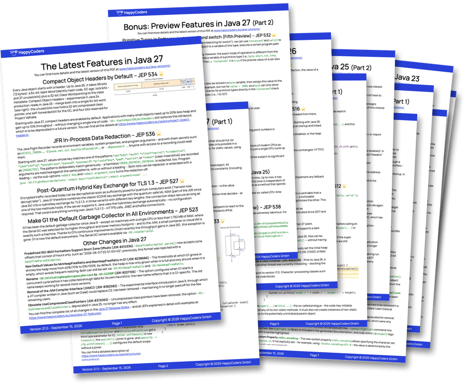
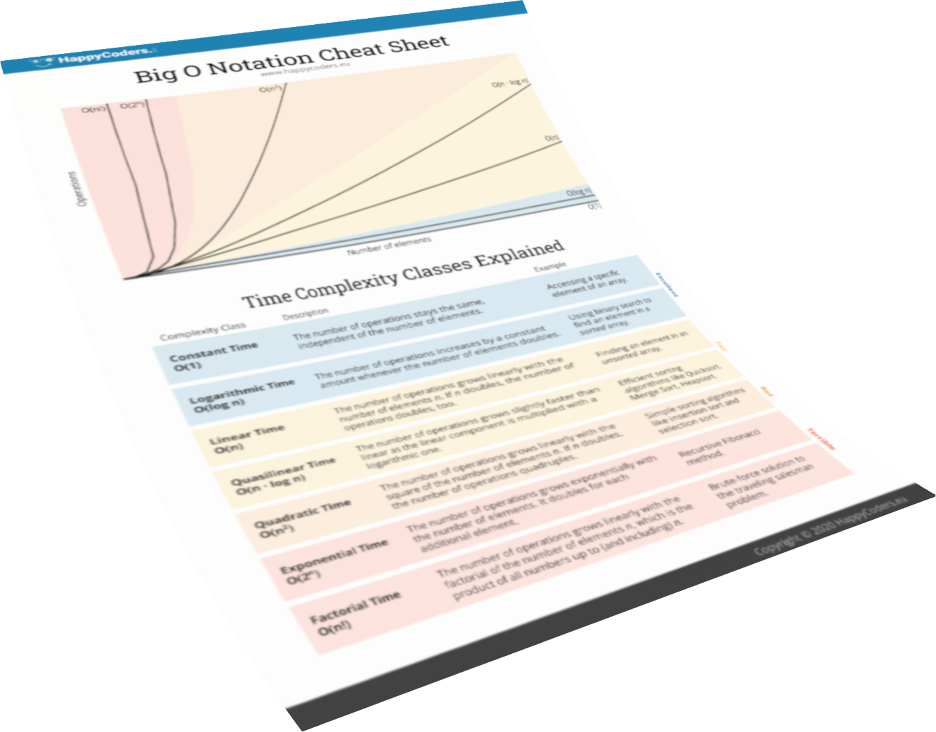
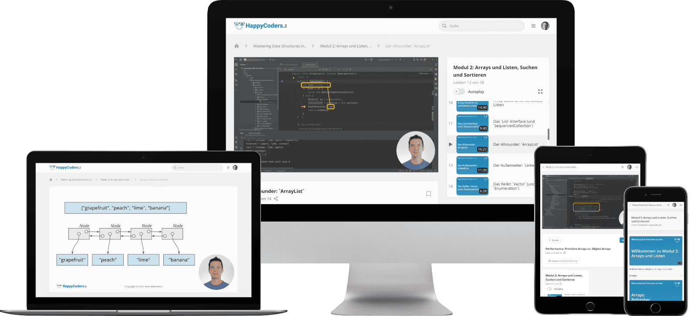

## Hi there 👋

I’m Sven Woltmann, a Java expert, trainer, speaker, and author with 30 years of Java experience – and an Oracle ACE Associate. With my company HappyCoders GmbH, I help Java teams modernize their applications and get the most out of modern Java.

I write in-depth articles on the latest Java versions and features, speak at conferences such as JavaLand, betterCode() Java, and Java Forum Stuttgart, and run hands-on Java trainings that help teams actually use the new features in production.

My blog [HappyCoders.eu](https://www.happycoders.eu/) is one of the most widely read Java blogs in the German-speaking world. You’ll also find my videos on [YouTube](https://www.youtube.com/@HappyCoders), the slides of my talks on [Speaker Deck](https://speakerdeck.com/svenwoltmann), and every new article in my [newsletter](https://www.happycoders.eu/newsletter/).

##  Java Trainings

Java has evolved massively since Java 8 – but is your team already using the new features? I run hands-on trainings on modern Java: Java 17, 21 & 25 (individually or as combined courses), Java Streams, and virtual threads & structured concurrency.

* **The latest language features** – records, sealed classes, pattern matching, virtual threads, and when each one actually helps.
* **Hands-on from the first session** – your developers write and run code themselves, not just watch slides.
* **Focused on your stack** – we cover the Java versions and topics your projects really use.

**What participants say:**

> “A deep, thorough overview of all the relevant Java features since Java 8 – and the chance to try out every one of them yourself.”

> “A complex topic broken down brilliantly (virtual threads).”

> “If you know Java, you can follow this trainer with ease. The exercises are well thought out and focused on the essentials.”

> “Pace and depth: top. The mix of theory and practice was very pleasant.”

> “Content and presentation almost flawless. What impressed me was how confidently you answered questions along the way.”

👉 [Java Trainings (English)](https://www.happycoders.eu/java-trainings/) \
👉 [Java-Schulungen (Deutsch)](https://www.happycoders.eu/de/java-schulungen/)

##  Java Versions PDF Cheat Sheet

**Stay up-to-date** with the latest Java features with [this PDF Cheat Sheet](https://www.happycoders.eu/java-versions/)!

* Avoid lengthy research with this **concise overview of all Java versions up to Java 27**.
* **Discover the innovative features** of each new Java version, summarized on a single page.
* **Impress your team** with your up-to-date knowledge of the latest Java version.

👉 [Download the Java Versions PDF](https://www.happycoders.eu/java-versions/)

_(Hier geht’s zur deutschen Version &rarr; [Java-Versionen PDF](https://www.happycoders.eu/de/java-versionen/))_

##  The Big O Cheat Sheet

With this [1-page PDF cheat sheet](https://www.happycoders.eu/big-o-cheat-sheet/), you’ll always have the **7 most important complexity classes** at a glance.

* **Always choose the most efficient data structures** and thus increase the performance of your applications.
* **Be prepared for technical interviews** and confidently present your algorithm knowledge.
* **Become a sought-after problem solver** and be known for systematically tackling complex problems.

👉 [Download the Big O Cheat Sheet](https://www.happycoders.eu/big-o-cheat-sheet/)

_(Hier geht’s zur deutschen Version &rarr; [O-Notation Cheat Sheet](https://www.happycoders.eu/de/o-notation-cheat-sheet/))_

##  🇩🇪 An alle Java-Programmierer, die durch fundierte Kenntnisse über Datenstrukturen besseren Code schreiben wollen

Trage dich jetzt auf die [Warteliste](https://www.happycoders.eu/de/mastering-data-structures-warteliste/) von „Mastering Data Structures in Java“ ein, und erhalte das beste Angebot!

👉 [Zur Warteliste](https://www.happycoders.eu/de/mastering-data-structures-warteliste/)
